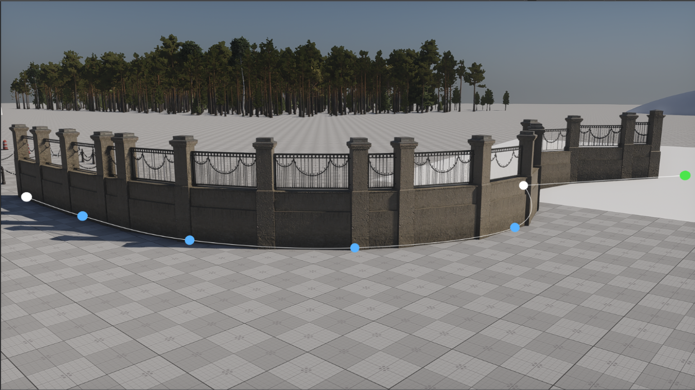
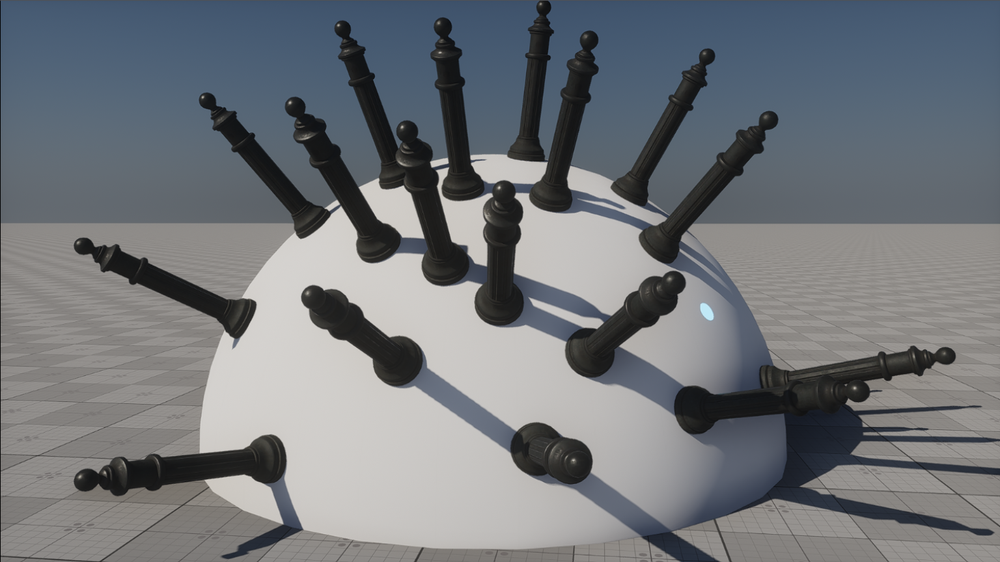

# Artist Tools for UNIGINE

Tools for everyday level work in the **UNIGINE 2.22 Editor**: place props, build fences and roads, hang wires between poles, check dimensions, unpack clutter, and bake textures for simpler meshes. Everything lives in one dockable window: **Windows → Artist Tools**.

[UNIGINE Store](https://store.unigine.com/en/publisher/1ee19a48-e62a-6d86-8136-9d637c69bc0c) · [Video overview — Part 1](https://www.youtube.com/watch?v=lC9pwmAlltY) · [Part 2](https://www.youtube.com/watch?v=L-KC0PTh6I8) · [Build from source](docs/BUILDING.md)



## What you can do

| Tool | Use it to… |
| --- | --- |
| **Object Placer** | Place props with a click, align them to a surface, and vary their rotation and scale. |
| **Path Placer** | Arrange fences, posts, and other repeating objects along an editable curve. |
| **Road** | Make roads and paths as meshes or decals, or bend existing meshes along a curve. |
| **Wires** | Place poles along a line or connect existing ones, then generate sagging wires, cables, or chains. |
| **Measure** | Check distances, slopes, and angles, or place a person-shaped height reference. |
| **Unpack Clutter** | Convert World Clutter, Mesh Clutter, and Mesh Cluster into regular nodes you can edit individually. |
| **Baker** | Bake albedo, shading, normals, and optional emission from detailed models onto a low-poly UV layout. |

The interface supports English and Russian and follows the editor's language settings. Hover over a control for help; shortcuts are listed at the bottom of each tab.

## Install

Get the prebuilt plugin from the **Artist tool** listing on the [UNIGINE Store](https://store.unigine.com/en/publisher/1ee19a48-e62a-6d86-8136-9d637c69bc0c).

For a manual installation, copy the plugin folder into your project so the binaries end up here:

```text
<project>/bin/plugins/zloy_pingvin/artist_tool/
```

Copy the default materials and textures of the plugin too: the [`data/plugins/zloy_pingvin/artist_tool/`](data/plugins/zloy_pingvin/artist_tool) folder of this repository goes to the same path in the data of your project, with its `.meta` files (they keep the GUIDs the tools look the materials up by):

```text
<project>/data/plugins/zloy_pingvin/artist_tool/
```

Use binaries matching your editor's platform, precision (float or double), and build (Release or Debug). Start or restart the editor, then open **Windows → Artist Tools**.

This repository contains the source code. To compile it yourself, see [Building Artist Tools](docs/BUILDING.md).

## Start using it

### Place objects on surfaces

Select a `.node`, `.mesh`, or imported model in the Asset Browser, click **Start placing**, then click a surface in the viewport. Press **Esc** to stop.

Enable **Normal Orientation** to follow the surface, or randomize rotation and scale for variation. Hold the mouse button to slide a newly placed object across the surface; use the wheel while holding it to rotate. **Shift + mouse wheel** cycles through assets of the same type in the folder.



### Build a fence or a row of objects

1. In **Path Placer**, click **New Path** and click surfaces to add points. Press **Esc** to finish.
2. Select assets in the Asset Browser and click **Add Selected Assets**.
3. Set their lengths and repeat counts, then click **Fill Path**.

Move the points to reshape the path. With **Live Update** enabled, the objects follow. Use corner points for sharp turns, **Closed Loop** for a loop, and **Start / End** assets for things like end posts. Paths are saved with the world, so you can return to them later.

### Make a road, path, or bent mesh

In **Road**, click **New Road**, place points, and press **Esc**. Set the width, then choose **Mesh**, **Decal**, or **Bent Mesh**. Pick a material or source mesh and click **Generate**.

Use per-point width and roll for widening sections and banked turns. **Lay On** selects the surface types used for ground snapping. **On Curve** excludes individual points from snapping, letting you raise sections for bridges and ramps. With a decal material using distance fade, raised sections can also create a gradual fade where the decal projects onto the ground. Generated meshes are saved to `roads/` beside the world, or to a folder you choose.

Use a mesh material for **Mesh** and a decal material for **Decal**. Vertex-color controls provide masks for your material, and the viewport preview lets you inspect them. **Bent Mesh** supports repeating assets with separate start and end pieces.

### Hang wires between poles

In **Wires**, click **New Line** and place points. Add pole assets and choose **At Points** to place a pole at each curve point, or **Every** to space poles along the curve at a set interval. To use poles already placed in the scene, choose **Connect Poles** and add them with **Add Poles**.

Put dummy nodes named `wire_1`, `wire_2`, and so on inside each pole asset to mark attachment positions. The tool connects matching numbers between poles: `wire_1` to `wire_1`, `wire_2` to `wire_2`, and so on.

Set **Sag** and **Random**, then choose **Cross**, **Ribbon**, **Tube**, or **Mesh** under **Make Of**. A custom mesh can turn the wire into a chain. Adjust individual spans with **Sag ×** and **Twist +**, tilt poles, and add an asset with the **Insulator** role to populate attachments. **Above Ground** keeps the wire above the sampled ground.

Under **Advanced Settings**, **End Offset** moves both wire ends inward from their attachment points. This is useful when an attachment is at the center of a post and the cable should start at its edge. Click **Generate** to save the result.

### Check scale and dimensions

In **Measure**, choose **Ruler**, **Angle**, or **Person**, then click in the viewport to place the points. You can snap to surfaces and mesh vertices, lock to an axis with **X / Y / Z**, and copy measurements as text.

Tap and release **Ctrl** over the viewport to switch surface/vertex snapping. **Shift + X / Y / Z** locks to a plane; hold **Shift** while placing or dragging a point for slower cursor movement. In Person mode, the mouse wheel adjusts the figure's height.

Enable the magnifier to see the area around the target point enlarged while placing or adjusting measurements. Use it together with snapping and slower cursor movement to align points precisely with object edges.

### Turn clutter into editable nodes

Select clutter or cluster nodes in the World Hierarchy, choose whether to disable, keep, or delete the originals, then click **Unpack**. The resulting objects are regular nodes. **Ctrl+Z** undoes the unpacking.

### Bake textures for a low-poly model

Open **Baker** and add the high-poly and low-poly nodes in the **Models** tab. Prepare a unique low-poly UV0 layout, choose the output maps and resolution, set the frontal/rear cage distances, then click **Bake**. Textures are saved beside the low-poly mesh asset, and its material is created or updated.

Use **As rendered** for layered materials and material graphs. **Groups** separates matching parts; **Fit cage** adjusts projection distances per part. Disable maps you want to keep when re-baking.

Enable **Show Cage** to inspect the projection shell directly in the viewport. **Fit Cage** tightens per-part distances within the global limits. Hold **− Shrink Front** or **+ Grow Front** to smoothly adjust the frontal distance: the buttons affect parts selected in the list, or all parts when none are selected. **Reset To Global** clears individual distance overrides.

## A few useful details

- Paths, roads, and wire lines keep their settings in the world; tool preferences are saved per project.
- Created nodes reference assets by GUID, so moving or renaming assets keeps those references intact.
- **Ctrl+Shift+F** finds the selected node's source asset in the Asset Browser. You can change this shortcut in the editor's hotkey settings under **Artist Tools**.
- When the editor's **Snap to Surface** is enabled, it handles path-point movement.

## Author and license

By **zloy_pingvin** · [Telegram](https://t.me/zloytux)

Plugin source: [MIT License](LICENSE). The UNIGINE SDK is not included and has its own license.
